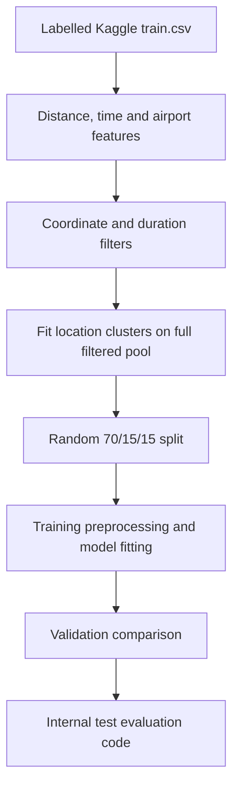

# NYC Taxi Trip Duration Prediction

An academic Python regression workflow using trip endpoints, pickup-time information and engineered spatial/time features to estimate taxi duration in seconds.

**Author:** [Mayur More](https://github.com/mayurmore0812).

## Explore

- [Python notebook and Code](NYC_Taxi_Trip_Duration.ipynb)
- [Dataset download, input schema and provenance](docs/DATA.md)
- [Features, models and evaluation workflow](docs/METHODS.md)
- [Limitations](docs/LIMITATIONS.md)
- [Independent data summary](docs/data-summary.json)
- [Source and licence notices](THIRD_PARTY_NOTICES.md)

## What the project implements

- Haversine and Manhattan-style endpoint distances, bearing and cyclic encodings.
- Pickup calendar features, weekend/rush-hour flags and proximity to JFK, LGA and EWR.
- Coordinate/duration filtering and 25 MiniBatchKMeans location zones.
- scikit-learn preprocessing pipelines, Ridge, Random Forest and HistGradientBoosting regression.
- Validation RMSE comparison, test MAE/MSE/RMSE/R² definitions and duration-group error analysis.



This diagram describes the existing implementation. The pre-split clustering and final model-selection condition are disclosed below.

## Data scope

Independent CSV inspection found **1,458,644 labelled trips** and **625,134 competition test rows**. Pickup dates span **2016-01-01–2016-06-30**. The labelled file is the modelling pool; the unlabelled competition test file is not used for internal testing.

The coordinate box and 20-second–4-hour duration filter retain **1,452,939 rows** and exclude **5,705**. These rules define the evaluation population and do not prove every excluded trip is erroneous. No raw trip-level data is distributed.

## Limitations


Current implementation limits:

- Location clustering uses the full filtered pool before the split, including future validation/test coordinates.
- The winner condition checks `RFR`, while the result label is `Random Forest Regressor`; it always chooses `hgb_best` with the current labels and can display a different winning name.
- The random holdout does not establish later-period generalization. Filtering and absent traffic/weather/route context limit operational interpretation.

The notebook includes saved evaluation outputs. These implementation limits still constrain interpretation of its results; performance on a random internal holdout does not establish production impact or future-period accuracy.

## Run locally

Notebook metadata records Python 3.12.4. Package versions from the original environment are unknown; `requirements.txt` is an unpinned dependency list, not a tested lockfile.

```powershell
python -m venv .venv
.\.venv\Scripts\python.exe -m pip install -r requirements.txt
.\.venv\Scripts\python.exe -m jupyterlab
```

Download [the Kaggle competition data](https://www.kaggle.com/competitions/nyc-taxi-trip-duration/data), sign in/accept its terms as required, and place `train.csv` beside the notebook. Start Jupyter from this repository root. Linux/macOS can use `.venv/bin/python` for the same commands.

The loader also accepts `train.zip` containing `train.csv`, or `nyc-taxi-trip-duration.zip` containing `train.zip`. It reads ZIP members in memory. Running all cells performs multiple large-data model fits; memory and runtime are not benchmarked. The Random Forest uses all available CPU cores (`n_jobs=-1`). The notebook does not export a checkpoint or a Kaggle submission.

## Attribution and reuse

Dataset: [Kaggle New York City Taxi Trip Duration](https://www.kaggle.com/competitions/nyc-taxi-trip-duration/data). Competition access/reuse is governed by its published terms; no permissive dataset redistribution licence is asserted. Raw train/test files are excluded. See [third-party notices](THIRD_PARTY_NOTICES.md). No blanket software licence is assigned to the analytical code.
