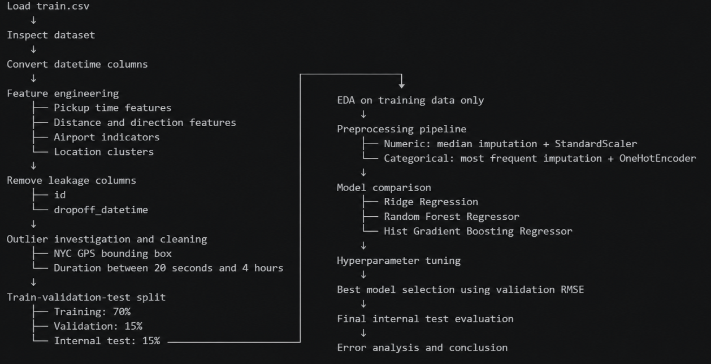

# Features, models and evaluation code

Notebook references use one-based cell positions including Markdown.

## Workflow diagram

Workflow overview extracted from the original project HTML export. The diagram summarizes the intended stages; the retained code fits location clusters after filtering and before the split, and its final selection condition is described in [limitations](LIMITATIONS.md).

## Implemented stages

| Stage | Implemented behavior | Cells |
|---|---|---|
| Load/check | Read labelled CSV/ZIP; inspect missing values and duplicates | 7–10 |
| Time | Month/day/hour/minute; weekend; hour 08–18 inclusive flag | 16, 21 |
| Distance/direction | Haversine, log distance, Manhattan-style approximation, bearing/cyclic encodings | 18–27 |
| Airports | Within 4 km of JFK/LGA/EWR at either endpoint | 29 |
| Feature exclusions | Remove id/dropoff timestamp; omit duration_min from model lists | 32, 66–68 |
| Filters | Both endpoints in bounding box; duration 20–14,400 seconds | 40–43 |
| Spatial zones | MiniBatchKMeans, 25 clusters, pooled endpoints before split | 51 |
| Split | Random 70/15/15, seed 42 | 54 |
| Preprocessing | Median numeric imputation, optional standard scaling, category most-frequent imputation and dense one-hot encoding | 71–74 |
| Initial estimators | Ridge, Random Forest and HistGradientBoosting | 79 |
| Retained configurations | One parameter combination for each nonlinear estimator | 82 |
| Test analysis | MAE/MSE/RMSE/R², residual plots, error by duration group | 85, 87 |

Numeric and categorical preprocessing inside model pipelines is fitted to training data. The location cluster transform is separate and already learned from all filtered data. The feature list contains 35 columns: four categorical and 31 numeric/binary columns. Dense one-hot encoding creates additional transformed columns.

Initial Ridge uses alpha 0.1. Initial Random Forest uses 100 trees/depth 10/leaf size 5; initial HGB uses 200 iterations/learning rate 0.08/31 leaves. Retained Random Forest: 300 trees, depth 30, leaf size 20, max_features `sqrt`. Retained HGB: 600 iterations, learning rate 0.10, 191 leaves, L2 0.03, leaf size 50. Final grids each have one candidate; the broader historical search is not rerun by these retained grids.

Predictions are floored at zero. RMSE selects configurations using validation scores. The final name condition has the limitation documented in [limitations](LIMITATIONS.md). The task uses metrics in seconds rather than asserting a Kaggle leaderboard score. MSE units are seconds squared; R² is unitless.
